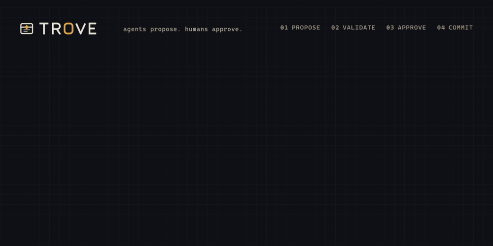
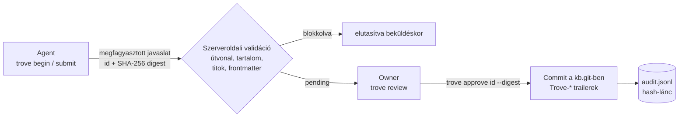

<p align="center">
  
</p>

<p align="center">
  <b>Tudásbázis, amit az AI agentek olvasnak, de csak ember módosíthat.</b><br>
  Multi-infra agent tudásbázis: markdown gitben, módosítás javaslatként, jóváhagyás digesthez kötve.
</p>

<p align="center">
  <a href="README.md">English</a> ·
  <a href="DESIGN.md">Design</a> ·
  <a href="SECURITY.md">Biztonság</a> ·
  <a href="AGENT-INSTRUCTIONS.md">Agent utasítások</a>
</p>

> [!WARNING]
> **ALPHA, élesben és bizalmas adatra ne használd.**
> Két belső, ellenséges szemléletű átnézés (jóváhagyási útvonal, bemenet-kezelés) leleteit javítottuk, de **független, szakértői biztonsági átnézés még nem volt**. Addig ne bízz rá olyan tudásbázist, amelyből agentek dolgoznak, és ne tedd ki nyilvános hálózatra. Lásd [SECURITY.md](SECURITY.md).

<p align="center">
  <picture>
    <source media="(prefers-color-scheme: dark)" srcset="assets/trove-hero.gif">
    <source media="(prefers-color-scheme: light)" srcset="assets/trove-hero-light.gif">
    
  </picture>
</p>

## A probléma

- Az agentek jobban dolgoznak közös, leírt tudással (runbookok, döntések, infra-jegyzetek).
- Ha az agent közvetlenül **írhatja** ezt a tudást, egy hamis tény, egy kiszivárgott titok vagy egy prompt injection oda kerül, ahonnan minden későbbi agent olvas.
- Egy személyes vagy kis csapatos tudásbázishoz a pull request nehézkes, az MCP kliens "megerősítés" ablaka pedig nem biztonsági határ.

A Trove-ban az olvasás szabad, minden módosítás megfagyasztott javaslat, amit egy ember a saját termináljáról (vagy a beépített webes felületen) hagy jóvá.

## Hogyan működik



1. **Javaslat.** A `submit` megfagyasztja a javaslatot: kap egy `id`-t és egy SHA-256 `digest`-et (bázis, agent, téma, `supersedes`, a rendezett változások). Később nem módosítható.
2. **Validáció.** Beküldéskor a szerver blokkolja a hibás útvonalat, tartalmat, a titkot és a hiányzó frontmattert, és figyelmeztetéseket csatol.
3. **Jóváhagyás.** A `review` a teljes diffet mutatja, **csonkítás nélkül**: minden megváltozott sor teljes hosszában látszik, a láthatatlan és vezérlőkarakterek `\u{....}` alakban. A review méretét a beküldési korlátok határolják (fájlonként 256 KiB, csomagonként 1 MiB), így amit látsz, pontosan az, amit a digest lefed és a commit alkalmaz. Hosszú review-t `| less`-szel olvass.
4. **Commit.** Az `approve <id> --digest <hash>` a szerveren egyetlen mutex alatt fut: szerep, állapot, digest egyezés, a tárolt tartalom újraszámolt digestje, már alkalmazott-e (commit trailer), elavultság, validáció a bázis ÉS a jelenlegi HEAD fáján (fájl/mappa és kis/nagybetűs ütközés), commit ideiglenes git indexszel, ellenőrzés, hogy a commit pontosan a javasolt utakat változtatja (`diff-tree`), kötelező audit-sor, végül `update-ref` compare-and-swap. Ha bármi nem stimmel (az audit írása is), semmi nem kerül be.

További részletek:

- **Commit trailerek:** `Trove-Proposal`, `Trove-Digest`, `Trove-Agent`, `Trove-Approver`, `Trove-Topic`. Induláskor a szerver ezekből állítja `applied`-re azt, ami a commit és az állapotírás között szakadt meg.
- **Javaslat állapotai:** `draft`, `pending`, `applied`, `rejected`, `aborted`, `expired`, `superseded`. A lezárt javaslatból a tartalom törlődik (csak az útvonal, a művelet, a méret és a digest marad); az alkalmazott tartalom a gitben van.
- **Fájlszintű elavulás** (minden lekéréskor a friss HEAD-hez számolva): `ready` (kész), `stale` (elavult: egy érintett fájl, annak szülő-útja, gyereke vagy kis/nagybetűs ikre változott a bázis óta), átfedés (másik függő javaslat ugyanazt vagy kapcsolódó utat érint). Nincs sor: bármelyik `ready` javaslat bármilyen sorrendben jóváhagyható.
- **Rebase:** elavult javaslatnál az agent `trove rebase <id>`-t futtat: a régi `superseded` lesz, új vázlat nyílik a friss HEAD-en (`supersedes` hivatkozással), a régi tartalom a `.trove/rebase/<id>/` alá kerül referenciának. A korábbi review nem vihető át.
- **Kicsi:** egyetlen Go bináris (szerver, kliens, MCP-kapu), csak a standard library, a git műveletekhez a `git` binárist hívja.

## Gyors kezdés

A `trove init` egy teljes első beállítást hoz létre: konfig, adatmappa, egy owner (approver) token és agent tokenek. A fő út a Docker:

```sh
docker build -t trove:local .                       # 1. image build
mkdir trove                                         # 2. a beállítás mappája, a tiéd
docker run --rm -it --user "$(id -u):$(id -g)" -v "$PWD/trove:/data" \
  trove:local init --host-dir "$PWD/trove"          # 3. varázsló (Enter: biztonságos alapérték)
docker run -d --name trove --read-only --cap-drop ALL \
  --security-opt no-new-privileges:true --user "$(id -u):$(id -g)" \
  -p 127.0.0.1:8470:8470 \
  -v "$PWD/trove/config:/config:ro" -v "$PWD/trove/data:/data" \
  trove:local serve --listen 0.0.0.0:8470           # 4. szerver indítása
```

- A végén az `init` a generált konfigot ugyanazzal a kóddal tölti be és ellenőrzi, mint a `trove serve`, és kiírja a következő lépéseket a saját útvonalaiddal: serve és Docker parancs, az owner és az agent környezete (külön), MCP kliens konfig Claude Code-hoz és Cursorhoz, import parancs.
- `--user`: a fájlok a tiéid, 0600 joggal, ezért a konténer a te uid-oddal fut (így sem root). Docker Desktopon (Windows, macOS) elhagyható; PowerShellben `-v "${PWD}\trove:/data"`.
- A `serve --listen 0.0.0.0:8470` csak a konténeren belül érvényes; a `-p 127.0.0.1:...` miatt a port a hoszton csak a loopbacken látszik.
- Terminál nélkül (CI, szkript, `docker run` `-it` nélkül) az `init` nem kérdez, `--yes` kell:

```sh
trove init --yes --dir trove --agent laptop --agent ci --reader docs --allowed-dirs runbooks,decisions
```

Amit az `init` létrehoz (mappák 0700, fájlok 0600; Windows ezeket a jogokat nem érvényesíti):

| Útvonal | Tartalom | Hova kerül |
|---|---|---|
| `trove/config/trove.json` | szerver konfig (`data_dir` `../data`, `tokens_file` `tokens.json`) | a szerverhez, csak olvasható (`/config`) |
| `trove/config/tokens.json` | csak SHA-256 hashek | a szerverhez, csak olvasható |
| `trove/data/` | üres adatmappa | a szerverhez (`/data`) |
| `trove/owner/<név>.token` | approver token | csak az ownerhez, agent környezetbe soha |
| `trove/agents/<név>.token`, `trove/readers/<név>.token` | agent és reader tokenek | agentenként egy fájl |

Biztonságos alapértékek és viselkedés:

- A `listen` alapból `127.0.0.1:8470`. Nem loopback címre (`0.0.0.0`, LAN vagy VPN cím) figyelmeztet (a Trove-nak nincs saját TLS-e) és megerősítést kér, `--yes` mellett `--allow-non-loopback` kell.
- A `validation.allowed_dirs` alapból `infra`, `projects`, `apps`, `claude`, `snippets`, `runbooks`, `decisions`, ha mást nem választasz (`--allowed-dirs`). Üres listát nem fogad el, az soha nem jelenti azt, hogy "minden".
- Meglévő beállítást `--force` nélkül nem ír felül; a `--force` minden tokent lecserél, a tudásbázist megtartja.
- A tokenek 256 bites véletlen értékek. Csak a token fájlokba kerülnek (atomikusan: ideiglenes fájl, majd átnevezés), kiírva vagy naplózva sehol nincsenek; a `--show-tokens` egyszer kiírja őket. Megszakított vagy hibás futás eltávolítja, amit írt.
- A te felhasználóddal futó agent az `owner/` mappát is olvashatja: az owner tokent tedd jelszókezelőbe vagy olyan mappába, amit az agent nem olvas.

A tudásbázis egy rövid üdvözlő jegyzettel (`INDEX.md`) indul, így az agentek azonnal syncelhetnek. Az `init` ezt első commitként közvetlenül az adatmappába írja (owner oldalon, token nélkül), `Trove-Bootstrap: welcome` trailerrel jelölve, és az audit hash-láncba is bekerül; csak üres tudásbázisba írja, meglévőhöz soha nem nyúl (`--force` mellett sem). Ha inkább egy meglévő tudásbázist importálnál, a beállítást `--no-welcome`-mal hozd létre: az import csak üres szerverre megy, és az üdvözlő commitot nem írja felül.

Natív bináris Docker helyett (Go 1.22+ és git kell):

```sh
go build -o trove ./cmd/trove                 # Windows: -o trove.exe
trove init                                    # létrehozza a ./trove mappát
trove serve --config trove/config/trove.json
```

Kézi beállítás `init` nélkül: a `trove token new <név> <szerep>` kiír egy tokent és a hozzá tartozó `{"name","role","sha256"}` sort a `tokens.json`-ba (minta: [`tokens.example.json`](tokens.example.json)); a [`trove.example.json`](trove.example.json) másolata `trove.json` néven, benne a `data_dir`, `listen` és `validation.allowed_dirs` beállítása. TLS-t a `tls_cert`/`tls_key` adhat, vagy egy elé tett reverse proxy / VPN.

Agent oldal (agent token):

```sh
export TROVE_URL=http://127.0.0.1:8470        # vagy a proxyd https:// címe
export TROVE_TOKEN_FILE="$PWD/trove/agents/agent.token"
mkdir -p ~/kb-mirror
trove sync --dir ~/kb-mirror
trove begin "backup runbook frissítése" --scope runbooks
# fájlok szerkesztése a tükörben
trove submit --dry-run
trove submit
```

Owner oldal (approver token, saját terminálon):

```sh
export TROVE_URL=http://127.0.0.1:8470
export TROVE_APPROVER_TOKEN_FILE="$PWD/trove/owner/owner.token"
trove review                          # függő javaslatok listája
trove review <id>                     # teljes diff, figyelmeztetések, digest
trove approve <id> --digest <digest>
trove reject <id> "indok"
```

Meglévő KB importja (approver token, csak üres szerverre, ezért a beállításhoz `trove init --no-welcome` kell). Titok-találat esetén az import megáll, semmi nem kerül be:

```sh
trove import /path/to/kb --history    # git előzménnyel (bundle), az előzményt is szkenneli
trove import /path/to/kb              # csak a fájlok, egy commitban
```

Ha csak a régi előzményben van titok-gyanú, és tudatosan vállalod: `--allow-secret-history` (figyelmeztetés lesz belőle). A HEAD-ben lévő találat mindig blokkol.

## Szerepek

Tokenenként egy szerep. A szerver csak a token SHA-256 hashét tárolja.

| Szerep | Mit tud | Mit nem | Hol legyen |
|---|---|---|---|
| `reader` | `sync`, `status`, keresés, olvasás | javaslatot nyitni, beküldeni | háttér-asszisztens, csak olvasó eszköz |
| `agent` | olvasás, saját vázlat: `begin`, `submit`, `rebase`, `abort`, `list` (saját) | jóváhagyni, elvetni, importálni, más javaslatát látni | az agent környezete |
| `approver` | `review`, `approve`, `reject`, `import`, `audit verify --remote` | teljes írási jognak számít | csak az owner gépén, agent környezetében soha |

Tokenek a kliensen:

| Változó | Kié | Mely parancsok |
|---|---|---|
| `TROVE_TOKEN` / `TROVE_TOKEN_FILE` | agent vagy reader | `sync`, `status`, `begin`, `submit`, `list`, `rebase`, `abort`, `instructions`, `mcp` |
| `TROVE_APPROVER_TOKEN` / `TROVE_APPROVER_TOKEN_FILE` | approver | csak `review`, `approve`, `reject`, `import`, `audit verify --remote` |

- Az approver parancsok soha nem olvassák a `TROVE_TOKEN`-t, és az URL-t csak `--url`-ből vagy `TROVE_URL`-ből veszik, a tükör `.trove/state.json`-jából soha (azt az agent írhatja).
- A `trove mcp` approver tokennel nem indul el.
- A kliens nem küld tokent sima `http://`-n nem loopback címre, csak `--insecure-http` kapcsolóval vagy `TROVE_INSECURE_HTTP=1` mellett (VPN-en, tailneten tudatos döntésként).

## Biztonsági modell

Teljes fenyegetésmodell: [SECURITY.md](SECURITY.md).

**Mi véd mit**

| Fenyegetés | Védelem |
|---|---|
| Többet hagysz jóvá, mint amit láttál | Csonkítás nélküli review; a jóváhagyáshoz a látott digest kell; újraszámolt digest; a `diff-tree` szerinti utak pontosan a javasolt utak |
| Verseny az ellenőrzés és az alkalmazás között | Az egész approve egy mutex alatt; az ág mozgatása `update-ref <új> <régi>` compare-and-swap |
| Prompt injection, láthatatlan Unicode | Vezérlő-, Unicode tag (U+E0000-E007F) és bidi karakter blokkolva; egyéb láthatatlan karakter figyelmeztet; minden kliens-kimenet escape-elve |
| Útvonal-trükkök | Csak `.md`, karakter-allowlist; tilos `..`, rejtett szegmens, `~`, `\`, `:`, Windows eszköznév, NFD, nem latin írás; kis/nagybetű-független ütközésvizsgálat; csak megengedett mappák |
| Titok a KB-ban | Regex titokszűrő a tartalomban, témában, scope-ban, útvonalban és importban |
| Token-kiszivárgás | Csak hash tárolva, konstans idejű összehasonlítás; token csak környezeti változóból vagy fájlból; külön agent és approver változó |
| Sor- és lemez-telítés | Agentenkénti és összesített korlát, 7 napos lejárat, napi bájt- és vázlat-kvóta a tárolt metaadatból |
| Auditnapló manipulálása | A hash-lánc felismeri a módosított, törölt, átrendezett sort; az `--expect-last` a levágott véget |

**Mi ellen NEM véd**

- Aki írni tudja az adatmappát, mindent meg tud kerülni (repo, javaslatok, auditnapló).
- Az auditnapló módosítás-felismerő, nem megváltoztathatatlan: aki írni tudja, újraszámolhatja a láncot. Az utolsó hash-t mentsd máshová.
- A titokszűrő a véletlen szivárgás ellen véd, szándékos kijátszás (darabolás, saját kódolás) ellen nem.
- Rutinszerű jóváhagyás és hamis tény bekerülése. A végső szűrő az owner.
- Nincs HTTP rate limit és kapcsolatszám-korlát, nincs teljes Unicode-normalizálás, IPv6 címre nincs figyelmeztetés.
- Kiszivárgott agent token a kvótáig írni és a nyitott sort lefoglalni tud; kiszivárgott approver token teljes írási jog.

**Üzemeltetési szabályok**

- Az approver tokent soha ne tedd shell profilba vagy közös `.env`-be: csak a jóváhagyás idejére add meg, olyan terminálban, amiben nem fut agent.
- Az elutasított kérések a `security.jsonl`-be kerülnek (forgatva, rate limitelve, nem hash-láncolva), nem az auditnaplóba.
- A kliens nem követ redirectet. Ha reverse proxy van előtte, a végleges `https://` címet használd.
- Import előtt ellenőrizd a tudásbázist: `docker run --rm -v "<repo>:/src" -v "<kb>:/kb:ro" -e TROVE_KB_DIR=/kb -w /src golang:1.22 go test ./internal/validate -run KB -v`. Az import blokkol titokra, vezérlőkarakterre, bináris fájlra, ütköző útvonalra és túl nagy fájlra vagy előzmény-blobra.
- Sebezhetőséget privátban jelents a GitHub "Report a vulnerability" (private vulnerability reporting) funkcióján át a repón.

### Validáció részletei (beküldéskor, szerveroldalon)

- **Útvonal (blokkoló):** csak `.md`, kanonikus relatív út, csak engedélyezett karakterek (ASCII betű, szám, `-_.()+,&'@!#=` és szóköz, valamint előre komponált latin betűk, pl. ékezetes magyar betűk). Tilos: `..`, abszolút út, rejtett szegmens bármilyen kis/nagybetűvel (`.git`, `.GIT`, `.git.`), `~` (8.3 rövid nevek, `GIT~1`), `\`, `:`, Windows eszköznevek (`CON`, `CON .md`, `COM1` ...), záró pont vagy szóköz, kombináló jelek (NFD alak), nem latin írásrendszer (homoglifák), láthatatlan és nem ASCII szóköz karakterek. Kis/nagybetű-független ütközés a bázissal, a HEAD-del vagy a javaslat más útjával tilos. Csak a megengedett mappák.
- **Tartalom (blokkoló):** érvénytelen UTF-8, vezérlőkarakterek (tab, LF, CR kivételével), Unicode tag karakterek (U+E0000-E007F, "ASCII smuggling"), bidi vezérlők. Méretkorlát fájlra, csomagra, fájlszámra; frontmatter (`title`, `updated`, `status`, kivétel: `INDEX.md`, `README.md`).
- **Titokszűrés (blokkoló):** a tartalomban, a témában, a scope-ban és az útvonalban. Privát kulcs blokk (sorokon átnyúlva és NBSP-vel is), `name=value`, `name := value`, `"name": "value"` és jelszó-alakú `name: value`, URL-be írt jelszó, ismert token-formátumok (GitHub, GitLab, AWS, Slack, Telegram, OpenAI/Anthropic, Google, JWT, Tailscale, Stripe, npm, Hugging Face, age), egy szint base64-be csomagolt token, saját minták. Keresés előtt a láthatatlan karakterek törlődnek.
- **Figyelmeztetés:** em/en dash, publikus IPv4 cím, láthatatlan karakter (zero width, NBSP), magas entrópiájú hosszú blokk, törlés, új fájl, nagy diff, a `--scope`-on kívüli út, több felső szintű mappa (a scope ezt nem nyomja el), egynél több mappás scope.

### Auditnapló

`<data>/audit.jsonl`, hash-láncolt, kanonikus JSON sorok (duplikált kulcs, extra szóköz, a sor végére fűzött adat elutasítva):

```sh
trove audit verify --file <data>/audit.jsonl
trove audit verify --file <data>/audit.jsonl --expect-last <korábban elmentett hash>
trove audit verify --remote          # approver
```

Az utolsó hash-t rendszeresen mentsd máshová: csak így derül ki, ha a napló végét levágták.

## Webes felület

A `trove serve` a **`/ui/`** útvonalon szolgálja ki a beágyazott böngészős felületet. Sima HTML, CSS és JavaScript, CDN és külső script nélkül. A böngészős belépés alapértelmezetten HTTPS-t használ. Beállítható egy külön, kizárólag a titkosított WireGuard tailnetről használható HTTP mód is.

- **Első beállítás:** egyszer add meg a meglévő owner (approver) tokent, majd kétszer az új jelszót. A jelszó 15-128 karakteres lehet. A beállítás csak az owner fiók létrehozásáig érhető el; a token utána nem reseteli a fiókot.
- **Belépés:** a saját jelszóval, laptopról, telefonról vagy más böngészőből. A szerver Argon2id hasht tárol (19 MiB, 2 iteráció, párhuzamosság 1, véletlen salt). Jelszó és nyers sessiontitok nem kerül naplóba.
- **Session:** véletlen, opaque access és refresh tokenek `HttpOnly; SameSite=Strict; Path=/` cookie-kban. HTTPS-en `Secure` és `__Host-` nevű cookie-kat használ. A tailnet HTTP mód külön, Secure nélküli cookie-neveket használ, mert a böngészők HTTP-n elutasítják a Secure cookie-t; a szerver csak a `100.64.0.0/10` tartományból érkező közvetlen kapcsolatot fogadja el. A JavaScript nem kapja meg a session tokeneket, nincs localStorage vagy sessionStorage. Az access 10 percig él; a refresh fix 7 napig, és minden frissítéskor cserélődik. Felhasznált refresh token visszajátszása visszavonja a sessioncsaládot. Egy legfeljebb 5 másodperces, azonos régi tokenpárhoz kötött retry-ablak kezeli a párhuzamos böngészőkéréseket.
- **Account:** jelszócsere és minden eszköz kijelentkeztetése. A jelszócsere minden sessiont visszavon. A felület 30 perc tétlenség után kijelentkezteti az aktuális sessiont. Legfeljebb 16 eszközsession marad meg.
- **Olvasás és jóváhagyás:** mappafa, markdown/forrás, fájlnév- és tartalomkeresés, wikilinkek, teljes diff, figyelmeztetések, digest, Approve és Reject. A jóváhagyás továbbra is a megtekintett digestet küldi, megváltozott vagy elavult javaslatot nem fogad el.
- **API-kompatibilitás:** az agent és reader bearer tokenek működnek tovább. Az owner jelszó beállítása után a nyers approver bearer token már nem hagyhat jóvá és nem utasíthat el: ehhez az owner böngészős session kell. A többi meglévő owner CLI-művelet megmarad. Az adminisztratív tokenek ne kerüljenek agenthez.
- **Böngésző bizalma:** a jelszavas session nem bizonyítja, hogy ember kattintott az Approve-ra. A belépett böngészőt vezérlő agent vagy rosszindulatú bővítmény a session nevében cselekedhet, bár a HttpOnly cookie-t nem olvashatja ki. Az owner böngészőjét/profilját agent ne vezérelje. Részletek: [SECURITY.md](SECURITY.md).
- Kikapcsolás: `"disable_ui": true`. Ez a statikus UI-t kapcsolja ki, a tárolt hitelesítést és sessionöket nem törli.

HTTPS-hez használhatsz közvetlen Trove TLS-t (`tls_cert`, `tls_key`) vagy HTTPS reverse proxyt. Proxy esetén a `web_trusted_proxies` listába csak a proxy pontos forrás IP-CIDR-je kerüljön, a proxy pedig írja felül az `X-Forwarded-Proto` fejlécet `https` értékkel. A `web_origin` a pontos HTTPS origin legyen.

Ha nem akarsz domaint vagy proxyt, engedélyezheted a közvetlen HTTP-t a tailneten: állítsd a `web_allow_tailnet_http` értékét `true`-ra, a `web_origin` pedig legyen a pontos tailnet URL, például `http://100.64.0.5:8470`. A böngészős hitelesítést a szerver csak a `100.64.0.0/10` tartományba eső közvetlen tailnet peer IP-ről fogadja el. A laptopon/telefonon a tailnet IP-t használd, ne a LAN címet. A WireGuard titkosítja a tailnetes forgalmat, de a HTTP-nak nincs TLS-védelme, ha kikerül a tailnetből; ezért ne tedd publikussá a 8470-es portot, és ne engedélyezd ezen az üzemmódon a LAN-hozzáférést. A session cookie-k ebben a módban nem lehetnek Secure jelölésűek.

A `GET /auth/state` mutatja, kell-e első beállítás, és az aktuális peer használhat-e HTTP-t. A `POST /auth/setup`, `/auth/login`, `/auth/refresh`, `/auth/logout`, `/auth/logout-all`, `/auth/password` és a `GET /auth/session` kezeli a böngészős sessiont. A cookie-val hitelesített írásokhoz pontosan egyező Origin és sessionhöz kötött CSRF cookie/fejléc kell; CORS nincs. A belépési/beállítási/jelszócsere-próbálkozások peer szerint és összesítve is korlátozottak.

A hitelesítés állapota: `<data_dir>/browser-auth.json`, atomikus írással, csak owner által olvasható fájljoggal. Jelszóhasht és sessiontitkok hashét tartalmazza, újraépítés és restart után is megmarad. A védett adatmappával együtt mentsd. Hibás állapotfájlnál a szerver leáll, nem nyitja meg újra a beállítást.

**Elfelejtett jelszó:** nincs publikus reset végpont vagy Docker-logban jelszó. Megbízható helyi adminisztrátori konzolon állítsd le a Trove-t, mozgasd ki a hitelesítési állapotot az adatmappából, majd indítsd el és végezd el az első beállítást az offline owner tokennel. A generált Compose-elrendezésnél:

```sh
docker compose stop trove
mv -i trove/data/browser-auth.json trove/browser-auth.recovery-backup.json
docker compose up -d
```

A mentést védd; session helyreállításához ne másold vissza, mert a régi jelszóhasht és sessionállapotot tartalmazza. A KB-t és az API-tokenek konfigurációját ez a reset nem módosítja. Agent ne kapjon írási jogot az adatmappához.

## MCP

A `trove mcp` stdio MCP szerver agent (vagy reader) tokennel; **approver tokennel megtagadja az indulást**.

Eszközök: `trove_search`, `trove_read`, `trove_list`, `trove_status`, `trove_begin`, `trove_write`, `trove_delete`, `trove_submit`, `trove_rebase`, `trove_abort`.

Approve, reject, import és review nincs. Egy üzenet legfeljebb 8 MiB. Az agentek a szabályokat a `trove instructions` paranccsal kapják (beágyazott [AGENT-INSTRUCTIONS.md](AGENT-INSTRUCTIONS.md)).

## Konfiguráció

Szerver: a `trove init` generálja, vagy a [`trove.example.json`](trove.example.json) másolata `trove.json` néven (vagy `TROVE_CONFIG`). A relatív utak a konfigfájl mappájához képest értendők.

| Kulcs | Mintaérték | Jelentés |
|---|---|---|
| `listen` | `127.0.0.1:8470` | figyelési cím; a `trove serve --listen` felülírja (pl. `0.0.0.0:8470` konténeren belül) |
| `data_dir` | `/data` | `kb.git/` (bare repo, `main` ág), `proposals/` (nyitott javaslatok), `archive/` (lezártak, csak metaadat), `audit.jsonl`, `tmp/`, `trove.lock` (egy szerverpéldány) |
| `tls_cert`, `tls_key` | üres | beépített TLS; vagy reverse proxy / VPN |
| `tokens_file` | `tokens.json` | token hashek ([`tokens.example.json`](tokens.example.json)) |
| `limits.per_agent` / `limits.total` | `5` / `20` | nyitott vázlat/javaslat |
| `limits.ttl_hours` | `168` | lejárat (7 nap) |
| `limits.max_file_bytes` / `limits.max_total_bytes` | 256 KiB / 1 MiB | fájlonként / javaslatonként |
| `limits.agent_bytes_per_day` / `limits.agent_begins_per_day` | 20 MiB / `100` | napi agentenkénti kvóta |
| `validation.allowed_dirs` | `infra`, `projects`, `apps`, `claude`, `snippets`, `runbooks`, `decisions` | felső szintű mappák; üres lista konfigurációs hiba |
| `validation.frontmatter_fields` | `title`, `updated`, `status` | kötelező frontmatter (`INDEX.md`, `README.md` kivétel) |
| `validation.extra_secret_patterns` | `[]` | saját titok-minták |
| `disable_ui` | `false` | `true` kikapcsolja a `/ui/` alatti webes felületet |
| `web_origin` | `https://trove.example.com` | pontos HTTPS origin; tailnet HTTP-nél a teljes URL, pl. `http://100.64.0.5:8470` |
| `web_trusted_proxies` | `["192.0.2.10/32"]` | csak a megbízható TLS proxy peer CIDR-jei, alapból üres |
| `web_allow_tailnet_http` | `false` | böngészős HTTP engedélyezése kizárólag közvetlen `100.64.0.0/10` peer címekről |

Kliens: környezeti változók (lásd [`.env.example`](.env.example)): `TROVE_URL`, `TROVE_DIR`, a fenti token-változók, és `TROVE_INSECURE_HTTP=1` tudatos, VPN-en belüli sima http-hez.

## Telepítés

**Bináris** (forrásból):

```sh
go build -o trove ./cmd/trove     # Windows: -o trove.exe
make build                        # dist/trove, statikus
make cross                        # minden platformra a dist/ mappába
```

**Docker**:

```sh
docker build -t trove:local .
cp docker-compose.example.yml docker-compose.yml   # egy trove init mappát vár ./trove alatt; igazítsd
docker compose up -d
```

Az image nem root felhasználóként fut (Alpine + git), csak olvasható root fájlrendszerrel is működik, a `8470`-es portot nyitja, a konfigot a `/config/trove.json`-ból olvassa, az adat a `/data` alatt van; az image-ben futó `trove init` a `/data` alá írja a beállítást (`TROVE_INIT_DIR`). Named volume-ot az image felhasználója írni tud; Linuxon hoszt mappához `--user` kell (lásd Gyors kezdés). A minta compose csak `127.0.0.1`-re köt, minden capability-t eldob, memória- és pid-korlátot állít. Az alap image-ek csak taggel vannak rögzítve; éles buildhez rögzítsd őket digesttel (`FROM image:tag@sha256:...`), a digestet magad ellenőrizve.

## Korlátok és roadmap

Az első kiadás korlátai: nincs TOTP-s második jóváhagyási csatorna, nincs értesítés, nincs HTTP rate limit, csak standard library-s Unicode-kezelés, a webes felületen nincs szerkesztés.

Tervben (a projekttervből, még nincs megépítve):

- [ ] Link-gráf réteg a `[[hivatkozásokból]]` és a frontmatter `related:` mezőből (a markdown és a git marad a forrás-igazság)
- [ ] Sorszintű, három-utas összefésülés nem átfedő javaslatokra (opcionális, a review-ban jelölve)
- [ ] Értesítés beküldéskor (Telegram vagy hasonló) jóváhagyás gombbal
- [ ] TOTP-s, digesthez kötött jóváhagyás agenten át (2. csatorna)
- [ ] Keresőindex (először SQLite FTS5)
- [x] Webes felület, 1-2. fázis: olvasó és jóváhagyó nézet (`/ui/`)
- [ ] Webes felület, 3. fázis: szerkesztés (javaslat a böngészőből)
- [ ] Több KB egy szerveren
- [ ] Erősebb audit-garancia (külön naplózó folyamat, append-only attribútum, távoli gyűjtő)

## Hozzájárulás

Issue és pull request szívesen. Sebezhetőséget privátban jelents a karbantartóknak, ne nyilvános issue-ban (az elérhetőség a nyilvános kiadás előtt lesz meghatározva).

```sh
gofmt -l .
go vet ./...
go test -race ./...
```

Go nélkül Dockerrel:

```sh
docker run --rm -v "$PWD:/src" -w /src golang:1.22 sh -c "gofmt -l . ; go vet ./... && go test -count=1 -race ./..."
```

A webes felület markdown-megjelenítőjének és link-szabályainak saját tesztjei vannak (a Node csak a futtatásukhoz kell, a buildhez soha):

```sh
docker run --rm -v "$PWD:/src" -w /src node:20-alpine node --test internal/webui/jstest/
```

A tesztek ideiglenes git repókat hoznak létre, ehhez `git` kell. A hero-animáció [HyperFrames](https://www.npmjs.com/package/hyperframes) kompozíció az `assets/src/hero/` alatt (újrarenderelési jegyzet a `<head>`-ben).

## Licenc

[MIT](LICENSE).
