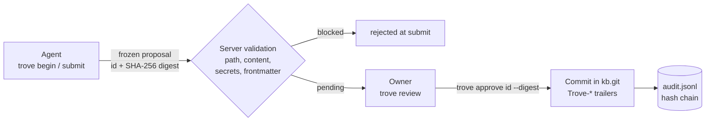

<p align="center">
  
</p>

<p align="center">
  <b>A knowledge base AI agents read, but only humans can change.</b><br>
  Multi-infra agent knowledge base: markdown in git, proposals in, approvals bound to a digest.
</p>

<p align="center">
  <a href="README.hu.md">Magyar</a> ·
  <a href="DESIGN.md">Design</a> ·
  <a href="SECURITY.md">Security</a> ·
  <a href="AGENT-INSTRUCTIONS.md">Agent instructions</a>
</p>

> [!WARNING]
> **Alpha software. Do not use it in production or for confidential data.**
> Findings from two internal adversarial reviews (approval path, input handling) have been fixed, but there has been **no independent expert security review** yet. Do not point agents at a Trove you rely on, and do not expose it to a public network. See [SECURITY.md](SECURITY.md).

<p align="center">
  <picture>
    <source media="(prefers-color-scheme: dark)" srcset="assets/trove-hero.gif">
    <source media="(prefers-color-scheme: light)" srcset="assets/trove-hero-light.gif">
    
  </picture>
</p>

## The problem

- Agents work better with shared, written knowledge (runbooks, decisions, infra notes).
- Letting agents **write** that knowledge directly is risky: a wrong fact, a leaked secret or a prompt injection lands where every later agent reads it.
- Pull requests are a heavy workflow for a personal or small-team knowledge base, and an MCP client's "confirm" prompt is not a security boundary.

Trove keeps reading free and turns every change into a frozen proposal that a human approves on their own terminal.

## How it works



1. **Propose.** `trove submit` freezes the proposal: an `id` and a SHA-256 `digest` over base, agent, topic, `supersedes` and the sorted changes. It cannot be edited afterwards.
2. **Validate.** On submit the server blocks bad paths, invalid content, secrets and missing frontmatter, and attaches warnings.
3. **Approve.** `trove review` shows the full diff, never truncated (long reviews: pipe through a pager, `trove review <id> | less -R`). `trove approve <id> --digest <hash>` only applies if the digest matches what was reviewed.
4. **Commit.** Under one mutex: digest recomputed from stored content, staleness and validation rechecked on base and current HEAD, commit built with a temporary index, `diff-tree` must equal the proposed paths, audit line written, then `update-ref` compare-and-swap. If anything fails, nothing is applied.

Also:

- **File-level staleness.** `ready` / `stale` is computed on every read against the fresh HEAD (a touched file, its parent or child path, or a case twin changed). Stale proposals are rebased with `trove rebase <id>`.
- **No queue.** Pending proposals are an unordered set; any `ready` one can be approved in any order. Overlaps are flagged, not blocked.
- **Hash-chained audit.** `<data>/audit.jsonl`, canonical JSON lines, checked by `trove audit verify`.
- **Small.** One Go binary (server, client, MCP gateway), standard library only, shells out to `git`.

## Quick start

Requires Go 1.22+ and `git`.

```sh
go build -o trove ./cmd/trove                 # 1. build (Windows: -o trove.exe)
trove token new owner approver                # 2. create tokens; put the printed
trove token new laptop-agent agent            #    {"name","role","sha256"} lines in tokens.json
cp trove.example.json trove.json              # 3. set data_dir, listen, validation.allowed_dirs
trove serve --config trove.json               # 4. run the server
```

Agent side (agent token):

```sh
export TROVE_URL=https://kb.example.com
export TROVE_TOKEN_FILE=~/.config/trove/agent-token
trove sync --dir ~/kb-mirror
trove begin "backup retention" --scope runbooks
# edit files in the mirror
trove submit --dry-run
trove submit
```

Owner side (approver token, own terminal only):

```sh
export TROVE_APPROVER_TOKEN_FILE=~/.config/trove/owner-token
trove review                          # pending proposals
trove review <id>                     # full diff, warnings, digest
trove approve <id> --digest <digest>
trove reject <id> "reason"
```

Bootstrapping an existing KB (approver token, only into an empty server; any secret finding stops the import):

```sh
trove import /path/to/kb --history    # with git history (bundle), history is scanned too
trove import /path/to/kb              # files only, one commit
```

`--allow-secret-history` turns findings that exist **only** in older history into warnings. A finding in HEAD always blocks.

## Roles

One role per token. The server stores only the SHA-256 hash of each token.

| Role | Can | Cannot | Where it lives |
|---|---|---|---|
| `reader` | `sync`, `status`, search, read | open or submit proposals | background assistants, read-only tools |
| `agent` | read, plus own drafts: `begin`, `submit`, `rebase`, `abort`, `list` (own) | approve, reject, import, see other agents' proposals | the agent's environment |
| `approver` | `review`, `approve`, `reject`, `import`, `audit verify --remote` | treat it as full write access | the owner's machine only, never an agent environment |

Client token variables are separate on purpose:

| Variable | Token | Used by |
|---|---|---|
| `TROVE_TOKEN` / `TROVE_TOKEN_FILE` | agent or reader | `sync`, `status`, `begin`, `submit`, `list`, `rebase`, `abort`, `instructions`, `mcp` |
| `TROVE_APPROVER_TOKEN` / `TROVE_APPROVER_TOKEN_FILE` | approver | only `review`, `approve`, `reject`, `import`, `audit verify --remote` |

## Security model

Full threat model: [SECURITY.md](SECURITY.md).

**What protects what**

| Threat | Defense |
|---|---|
| Approving more than you saw | Review is never truncated; approval requires the reviewed digest; digest recomputed from stored content; `diff-tree` must equal the proposed paths |
| Race between check and apply | The whole approve runs under one mutex; the branch moves with `update-ref <new> <old>` compare-and-swap |
| Prompt injection, invisible Unicode | Control, Unicode tag (U+E0000-E007F) and bidi characters blocked in content; other invisible characters warned; client output escaped |
| Path tricks | `.md` only, character allowlist; no `..`, hidden segments, `~`, `\`, `:`, Windows device names, NFD or non-Latin scripts; case-insensitive collision checks; allowed folders only |
| Secrets in the KB | Regex secret filter on content, topic, scope, path and import (private keys, `name=value`, known token formats, one level of base64) |
| Token leakage | Hash-only storage, constant-time compare; tokens from env or file, never a flag; approver commands never read `TROVE_TOKEN` and take the URL only from `--url` / `TROVE_URL`; no token over plain `http://` to a non-loopback host without `--insecure-http` |
| Queue and disk flooding | Per-agent and total open limits, 7-day expiry, daily byte and begin quotas computed from stored metadata |
| Tampered audit log | Hash chain detects edited, removed or reordered lines; `--expect-last` detects truncation |

**What it does NOT protect against**

- Anyone who can write the data directory can bypass everything (repo, proposals, audit log).
- The audit log is tamper-evident, not immutable: a writer can recompute the whole chain. Save the last hash elsewhere.
- The secret filter catches accidental leaks, not deliberate evasion (splitting, custom encoding).
- Routine rubber-stamp approvals and false facts. The owner is the last filter.
- No HTTP rate limiting or connection limits, no full Unicode normalization, no warning for IPv6 addresses.
- A leaked agent token can fill the open queue until it is revoked. A leaked approver token is full write access.

**Operating rules**

- Never put the approver token in a shell profile or a shared `.env`. Provide it only for the approval, in a terminal that no agent runs in.
- Rejected requests are logged to `security.jsonl` (rotated, rate limited, not hash-chained), not to the audit log.
- The client does not follow redirects. If a reverse proxy sits in front, use the final `https://` URL.
- Check a knowledge base before importing it: `docker run --rm -v "<repo>:/src" -v "<kb>:/kb:ro" -e TROVE_KB_DIR=/kb -w /src golang:1.22 go test ./internal/validate -run KB -v`. Import blocks secrets, control characters, binary files, colliding paths and oversized files or history blobs.
- Report vulnerabilities privately through GitHub's "Report a vulnerability" (private vulnerability reporting) on the repository.

## MCP

`trove mcp` is a stdio MCP server that runs with an agent (or reader) token. It **refuses to start with an approver token**.

Tools: `trove_search`, `trove_read`, `trove_list`, `trove_status`, `trove_begin`, `trove_write`, `trove_delete`, `trove_submit`, `trove_rebase`, `trove_abort`.

There is no approve, reject, import or review over MCP. Max message size is 8 MiB. Agents get their rules from `trove instructions` (the embedded [AGENT-INSTRUCTIONS.md](AGENT-INSTRUCTIONS.md)).

## Configuration

Server: copy [`trove.example.json`](trove.example.json) to `trove.json` (or point `TROVE_CONFIG` at it).

| Key | Example value | Meaning |
|---|---|---|
| `listen` | `0.0.0.0:8470` | listen address |
| `data_dir` | `/data` | holds `kb.git/`, `proposals/`, `archive/`, `audit.jsonl`, `tmp/`, `trove.lock` |
| `tls_cert`, `tls_key` | empty | built-in TLS; or put a reverse proxy / VPN in front |
| `tokens_file` | `tokens.json` | token hashes (see [`tokens.example.json`](tokens.example.json)) |
| `limits.per_agent` / `limits.total` | `5` / `20` | open drafts and proposals |
| `limits.ttl_hours` | `168` | expiry (7 days) |
| `limits.max_file_bytes` / `limits.max_total_bytes` | 256 KiB / 1 MiB | per file / per proposal |
| `limits.agent_bytes_per_day` / `limits.agent_begins_per_day` | 20 MiB / `100` | daily per-agent quotas |
| `validation.allowed_dirs` | `infra`, `projects`, `apps`, `claude`, `snippets`, `runbooks`, `decisions` | top-level folders; an empty list is a config error |
| `validation.frontmatter_fields` | `title`, `updated`, `status` | required frontmatter (`INDEX.md`, `README.md` exempt) |
| `validation.extra_secret_patterns` | `[]` | your own secret regexes |

Client: environment variables (see [`.env.example`](.env.example)): `TROVE_URL`, `TROVE_DIR`, the token variables above, and `TROVE_INSECURE_HTTP=1` for a deliberate plain-http setup inside a VPN.

## Install

**Binary** (from source):

```sh
go build -o trove ./cmd/trove     # current platform
make build                        # dist/trove, static, trimmed
make cross                        # linux, darwin, windows (amd64, arm64) into dist/
```

**Docker**:

```sh
docker build -t trove:local .
cp docker-compose.example.yml docker-compose.yml   # adjust to your environment
docker compose up -d
```

The image runs as a non-root user on Alpine with `git`, works with a read-only root filesystem, exposes `8470`, reads `/config/trove.json` and keeps data in `/data`. The example compose file binds to `127.0.0.1` only, drops all capabilities and sets memory and pid limits. Base images are pinned by tag only: for production builds pin them by digest (`FROM image:tag@sha256:...`) after checking the digest yourself.

## Limits and roadmap

First release limits: no TOTP second approval channel, no notifications, no HTTP rate limit, standard-library Unicode handling only.

Planned (from the project plan, not built yet):

- [ ] Link-graph layer from `[[links]]` and frontmatter `related:` (markdown and git stay the source of truth)
- [ ] Line-level three-way merge of non-overlapping proposals (opt-in, flagged in review)
- [ ] Notification on submit (Telegram or similar) with an approve button
- [ ] TOTP-based approval through the agent, bound to the digest (second channel)
- [ ] Search index (SQLite FTS5 first)
- [ ] Read-only web review view
- [ ] Multiple knowledge bases per server
- [ ] Stronger audit guarantees (separate logger, append-only attribute, remote collector)

## Contributing

Issues and pull requests are welcome. Please report vulnerabilities privately to the maintainers, not in a public issue (the contact will be defined before the public release).

```sh
gofmt -l .
go vet ./...
go test -race ./...
```

Without a local Go toolchain:

```sh
docker run --rm -v "$PWD:/src" -w /src golang:1.22 sh -c "gofmt -l . ; go vet ./... && go test -count=1 -race ./..."
```

Tests create temporary git repositories, so `git` is required. The hero animation is a [HyperFrames](https://www.npmjs.com/package/hyperframes) composition in `assets/src/hero/` (re-render notes in its `<head>`).

## License

[MIT](LICENSE).
